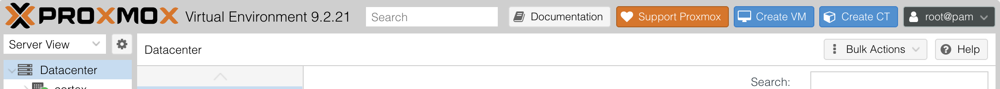

# pve-nag-to-button

Replace the Proxmox VE "No valid subscription" popup with a persistent **Support Proxmox** button in the web UI header.

Proxmox VE is an incredible project, built and maintained with real care, and the people behind it deserve support. The popup on every login doesn't serve that well: people learn to click past dialogs, and less technical colleagues are put off by a warning that looks like an error. And anyone is likely to get annoyed, which may be counterproductive to recruting new donations. A button that is always visible keeps the ask in front of everyone who uses the server, without getting in anyone's way.



## What it does

- Overrides `Proxmox.Utils.checked_command` so the gated action (login, update, etc) runs without the popup.
- Adds a "Support Proxmox" button next to *Documentation* that opens the Proxmox VE subscription page. Its tooltip says the server has no subscription and what one would provide, so a future admin with budget knows where to go.
- An apt `DPkg::Post-Invoke` hook re-applies both after Proxmox packages are upgraded.

It doesn't edit Proxmox's code. It appends two clearly marked blocks (`/* BEGIN pve-nag-to-button */` … `/* END … */`) to the end of two JavaScript files. The whole tool is one short shell script you can read in a few minutes before running it as root.

## Install

```sh
sh pve-nag-to-button install --dry-run   # show what would change
sh pve-nag-to-button install
```

Then hard-refresh the browser to replace the cache.

```sh
pve-nag-to-button status
pve-nag-to-button uninstall              # removes the blocks, hook and script
```

The button is Proxmox orange, so it stands out and isn't mistaken for the blue action buttons. But you can customize the top of the script before installing.

## Why not the usual nag-removal approaches?

- One common approach uses `sed` edits of Proxmox's JavaScript that depend on upstream code staying exactly the same. When it changes, the edit either does nothing, leaves broken JS, or stops web UI from loading. Appending an override doesn't depend on the surrounding code.
- Other nag-removers use encoded or obfuscated installers that ask you to run code as root that you can't read. Even when the intent is harmless, that's a habit worth not teaching people to accept.
- Another approach makes the server report a fake subscription it doesn't have to disable the popup nag. Beyond obvious problems, this also misleads the next admin who may think there's a valid license, uses the check license tooling, and then begins getting nags. 

## A suggestion for Proxmox

I'd love for this repo to become unnecessary. A persistent header button alone, or even allowing for a single popup nag once per login, or once a week or something, would annoy users less, and potentially convert better than the current nag. If Proxmox ships something like this, I'll point this README at it and archive the repo.

## Scope and limits

- Tested on Proxmox VE 9.2. If a future release changes the header, the button just won't appear; nothing breaks.
- The mobile UI (`/?mobile=1`) is separate and doesn't currently get the button.
- Proxmox Backup Server and Mail Gateway share the popup code but are not modified by this repo. Support for them is planned.

## License

MIT. Not affiliated with or endorsed by Proxmox Server Solutions GmbH. "Proxmox" is a trademark of its owner.